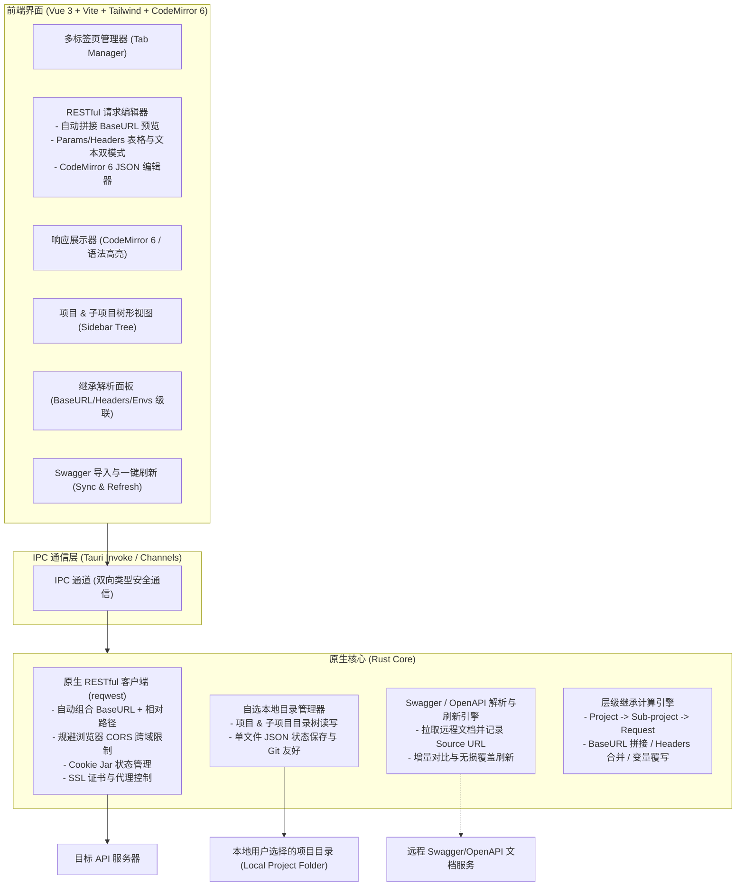

# JustAPI 🚀

> 极简、轻快、纯本地、无登录绑定的跨平台 RESTful API 调试客户端（支持 macOS & Windows）。

---

## 💡 为什么做 JustAPI？

目前主流的 API 调试工具（如 Postman、Insomnia 等）逐渐变得愈发臃肿：
- **强制云端登录**：甚至把本地数据强行上传云端，带来接口数据泄露风险。
- **资源占用居高不下**：基于重型 Electron，冷启动需要数秒，动辄占用 500MB~1GB 内存。
- **功能繁杂过度设计**：充斥着团队协作、API 治理、监控计费、各种非高频协议等普通开发者极少用到的模块。

**JustAPI 的核心设计准则：**
1. **专精 RESTful**：拒绝一切不必要的非 RESTful 复杂协议（砍掉 GraphQL、gRPC、WebSocket 等），聚焦把日常开发中 95% 以上高频使用的 RESTful 调试体验做到极致。
2. **目录即项目 (Folder-as-Project)**：支持自由选择任意本地磁盘目录作为存储空间（可直接存放在后端代码仓库的 `api-docs/` 目录），天然支持 Git 版本协同。
3. **主项目与子项目层级继承**：一个主项目下可设立多个子项目（如微服务/模块），子项目的 **BaseURL、通用请求头 (Headers)、环境变量 (Envs)** 均可直接继承主项目或按需覆盖，请求发送时自动拼接 BaseURL。
4. **Swagger/OpenAPI 导入与一键刷新**：支持从远程 URL 一键导入接口，并持久化记录源 URL，后端接口变更时支持一键无损同步刷新。
5. **表格与纯文本双模式快速编辑**：Query Params 与 Headers 支持在「键值对表格」与「纯文本模式 (Bulk Edit)」之间无缝切换与双向实时解析，方便整段复制粘贴。
6. **轻量极速与离线优先**：秒级冷启，严格裁剪运行时内存，离线即用，零账号绑定。

---

## 🛠️ 技术选型推荐与内存考量

为了达成「轻量、省内存、跨平台、高性能」的目标，**核心推荐基于 Tauri 2.0 构建（配合 Windows 专属内存裁剪）**，同时保留 Flutter Desktop 作为无浏览器内核的备选评估：

| 技术选型方案 | 预估打包体积 | 真实内存占用 (macOS / Windows) | 跨域处理 (CORS) | 推荐指数 | 评估说明 |
| :--- | :--- | :--- | :--- | :--- | :--- |
| **方案 A: Tauri 2.0 (Rust + Web)** | **~15 - 25 MB** | **macOS ~40-60 MB**<br>**Windows ~80-100 MB (调优后)** | 完美（Rust 原生 reqwest 执行） | ⭐⭐⭐⭐⭐ (核心推荐) | 极速冷启动，体积极小。Web 生态对 CodeMirror 6、Tailwind 动态表单有断层级开发优势 |
| **方案 B: Flutter Desktop (Dart)** | ~25 - 40 MB | **macOS ~40-60 MB**<br>**Windows ~40-60 MB** | 完美（原生 Dart IO 执行） | ⭐⭐⭐⭐☆ (备选) | 真正的无 Chromium 单进程原生渲染，Windows 内存天然极低；但桌面代码高亮/折叠编辑器生态较弱 |
| **方案 C: Wails v2/v3 (Go + Web)** | ~20 - 30 MB | macOS ~50-70 MB<br>Windows ~120-180 MB | 完美（Go 原生 net/http 执行） | ⭐⭐⭐☆☆ | Windows 同样走 WebView2 多进程，开发门槛适中但生态插件不如 Tauri 丰富 |
| **方案 D: Electron** | ~80 - 150 MB | macOS ~250-400 MB<br>Windows ~300-600 MB | 完美（Node.js 端执行） | ⭐⭐☆☆☆ | 丧失了「精简低耗」的核心卖点，坚决不选 |

### ⚠️ Windows 端 WebView2 内存实况与裁剪优化策略

> **实况说明**：Tauri 在 Windows 上依赖系统的 Edge WebView2 (Chromium 内核)。默认情况下会拉起 Browser、GPU、Renderer 等多个 `msedgewebview2.exe` 进程，合计内存常驻可达 **120MB ~ 200MB**。很多宣传所谓的 30MB 仅适用于 macOS (WebKit)。

**针对 JustAPI 的专项优化方案（已纳入落地实现）**：
通过向 WebView2 注入底层 Chromium 启动标志，剥离不必要的独立进程，将 Windows 常驻内存严格控制在 **80MB 左右**：
```rust
// 在 Rust 入口处针对 Windows 注入精简启动参数
#[cfg(target_os = "windows")]
{
    std::env::set_var(
        "WEBVIEW2_ADDITIONAL_BROWSER_ARGUMENTS",
        concat!(
            "--disable-gpu ",                   // 砍掉独立的 GPU 进程（直接节省 40-60MB）
            "--in-process-gpu ",                // 将图形绘制合并入主进程
            "--renderer-process-limit=1 ",      // 严格限制渲染进程数量
            "--disable-background-networking ", // 禁用无用后台网络探测
            "--disable-extensions ",            // 禁用扩展支持
            "--disable-features=AudioServiceOutOfProcess ", // 禁用独立音频进程
            "--js-flags=--max-old-space-size=64" // 限制 V8 JS 堆内存上限
        )
    );
}
```

### 🎯 确定技术栈组合 (方案 A)：
- **桌面底座**：Tauri 2.0 (Rust) + `reqwest` (开启 gzip/brotli/multipart/cookies) + `tokio`
- **前端框架**：Vue 3 (Composition API, `<script setup>`) + TypeScript + Vite
- **UI 与样式**：Tailwind CSS + `shadcn-vue` (基于 Radix Vue，无额外 Runtime 开销)
- **代码编辑器**：**CodeMirror 6**（仅 ~200KB，按需加载 JSON 语法/折叠/高亮，秒级冷启，**坚决避开** 3~5MB 且耗内存的 Monaco Editor）
- **高性能 JSON 处理**：**Rust 原生 `serde_json`**（异步工作线程流式执行，支持超大 JSON 毫秒级格式化与压缩，严禁任何前端自动格式化篡改，杜绝 V8 主线程卡顿与大数精度丢失）
- **状态管理**：Pinia + `@vueuse/core` (提供完善的快捷键与视窗工具)
- **图标库**：`lucide-vue-next`
- **数据持久化 (Local-First)**：目录化单文件 JSON（每个请求独立文件，对 Git 协同与版本 diff 天然友好）

---

## 🎯 核心功能规划 (RESTful 专精)

```
JustAPI 核心功能全景
├── 1. RESTful 请求构建器 (Request Builder)
│   ├── 标准 RESTful 动词 (GET, POST, PUT, DELETE, PATCH, HEAD, OPTIONS)
│   ├── 智能 BaseURL 拼接：
│   │   ├── 继承层级：主项目 BaseURL -> 子项目 BaseURL -> 接口相对路径
│   │   └── 实时拼接完整 URL 预览与校验
│   ├── Path Variables 路径参数：
│   │   └── 输入 `/users/{id}` 或 `/users/:id` 自动提取路径参数输入项，发送时智能替换
│   ├── Query Params 编辑：
│   │   ├── 表格模式 (Key-Value Grid)
│   │   └── 纯文本模式 (Bulk Edit 快捷解析，支持 key=value / key: value 多行粘贴)
│   ├── Headers 编辑 & 极简鉴权：
│   │   ├── 继承合并：自动继承主项目/子项目的全局与模块 Header
│   │   ├── 极简鉴权：不设冗余独立 Auth 面板，统一在 Headers 表格/文本中配置 (如 Authorization: Bearer {{token}})
│   │   ├── 表格模式 (Key-Value Grid，带常见 Header 自动补全)
│   │   └── 纯文本模式 (Bulk Edit 快速粘贴解析)
│   ├── Body 模式 (专注于 RESTful 常用格式)：
│   │   ├── JSON 编辑器：默认严禁自动格式化（尊重用户原始排版与内容）
│   │   ├── 手动高性能格式化 (Prettify) / 压缩 (Minify)：基于 Rust `serde_json` 异步非阻塞执行
│   │   └── Form-Data / x-www-form-urlencoded / Raw 纯文本格式
│   └── 快捷发送 (Cmd/Ctrl + Enter) 与即时取消
├── 2. 项目、子项目与继承体系 (Project & Sub-project)
│   ├── 自由选择存储目录：一个目录即一个主项目 (Project)
│   ├── 子项目 (Sub-projects / Modules) 树形划分（如微服务/功能模块）
│   ├── 三大核心属性继承规则 (Project -> Sub-project -> Request)：
│   │   ├── BaseURL：子项目可直接继承主项目，或自定义覆盖
│   │   ├── Headers：子项目可继承叠加主项目通用 Header，亦可局部重写
│   │   └── 环境变量：子项目继承主项目环境变量，且允许子项目同名变量优先覆盖
│   └── 本地多文件组织：纯 JSON 文件，天然与 Git 协同、无合并冲突
├── 3. Swagger / OpenAPI 导入与实时刷新 (Swagger Engine)
│   ├── 支持从 URL 或本地文件一键导入 Swagger 2.0 / OpenAPI 3.0 / 3.1
│   ├── 来源持久化记录：记录每个子项目或模块绑定的 Swagger Source URL
│   ├── 一键刷新 (Refresh API) 与无损合并规则 (Smart Merge)：
│   │   ├── 已删除接口：打上 [Deprecated / 已下线] 标记，坚决不物理删除本地文件，杜绝调试数据丢失
│   │   └── 已变更接口：更新 Path 与参数定义，无损保留用户已填好的具体测试参数 Value
│   └── 自动解析 Swagger 中的 Path 参数与 Query 参数模板
├── 4. 响应查看器 (Response Viewer)
│   ├── 状态标识 (Status Code 着色, Duration 耗时, Size 大小)
│   ├── JSON Body 高亮、格式化、折叠展开、关键字检索
│   ├── 超大响应保护机制 (Large Response Protection)：
│   │   └── 体积 > 5MB 时自动截断预览 (1MB)，提示另存为本地文件，杜绝 DOM/CodeMirror 假死
│   ├── Response Headers 列表查看
│   └── 响应数据一键复制 / 另存为文件
└── 5. 常用快捷与轻量网络配置
    ├── 快捷键流 (Cmd/Ctrl + Enter 发送, Cmd/Ctrl + S 保存, Cmd/Ctrl + R 刷新 Swagger)
    ├── Cookie 会话管理 (Cookie Jar 自动管理与手动清除)
    └── SSL 证书忽略 (支持自签名证书) 与本地网络代理 (Proxy)
```

---

## 📁 本地数据存储规范 (目录即项目，Git 友好)

用户在首次使用或新建时，可**自由选择任意本地磁盘目录**作为主项目根目录（例如直接选择本地 Git 仓库下的 `docs/api` 目录）：

```text
/Users/username/Projects/my-mall-api/      # 用户自选的主项目目录
├── .justapi/
│   ├── project.json                       # 主项目全局配置：
│   │                                      # - 项目名称、描述
│   │                                      # - 全局 BaseURL (如 https://api.dev.mall.com)
│   │                                      # - 全局通用 Headers (如 Authorization, X-Client-ID)
│   │                                      # - 全局环境变量列表 (Dev, Prod, Local)
│   │                                      # - 全局 Swagger 导入源 URL 记录 (可选)
├── user-service/                          # 子项目 1 (子模块 / 微服务)
│   ├── .subproject.json                   # 子项目配置：
│   │                                      # - 是否继承主项目 BaseURL (或重写为 /user-api)
│   │                                      # - 子项目继承/叠加 Headers
│   │                                      # - 子项目专属环境变量与覆盖配置
│   │                                      # - 子项目绑定的 Swagger Source URL (用于一键刷新)
│   ├── login.json                         # 具体 RESTful 请求定义 (单文件独立存储)
│   ├── get-profile.json
│   └── update-profile.json
├── order-service/                         # 子项目 2
│   ├── .subproject.json                   # 包含独立的 Swagger URL
│   ├── create-order.json
│   └── query-order.json
├── history.json                           # 本地调试历史 (上限 200 条轻量元数据，不存大 Response 实体)
└── .gitignore                             # 自动将 history.json 加入忽略清单，避免个人调试历史污染团队仓库
```

> **Git 协同优势**：每个请求单独一个 `.json` 文件，多人共同维护同一份接口时，使用 Git pull/merge 不会产生整个项目的合并冲突，代码评审 (Code Review) 极其清晰。同时 `history.json` 自动被 git 忽略，保持仓库整洁。

---

## 🏗️ 架构设计



---

## 📂 建议代码目录结构 (基于 Tauri 2.0)

```text
JustAPI/
├── README.md               # 项目介绍、架构规范与数据格式
├── TODO.md                 # 实施计划与任务跟踪清单
├── src-tauri/              # Rust 原生后端工程
│   ├── Cargo.toml          # Rust 依赖 (reqwest, serde, tauri, tokio...)
│   ├── tauri.conf.json     # Tauri 窗口、权限与跨平台配置
│   ├── icons/              # 跨平台 App 图标
│   └── src/
│       ├── main.rs         # 原生应用入口 (含 Windows WebView2 参数裁剪)
│       ├── http/           # 原生 HTTP 请求调度与 URL 自动拼接引擎
│       ├── storage/        # 本地自选项目目录扫描、JSON 读写
│       ├── swagger/        # Swagger/OpenAPI 拉取、解析与刷新引擎
│       ├── inherit/        # BaseURL / Headers / 环境变量级联继承解析
│       └── commands.rs     # 暴露给前端调用的 Tauri Command 命令层
├── src/                    # Web 前端工程 (Vite + Vue 3 + TS)
│   ├── assets/             # 静态资源与 Tailwind 全局样式
│   ├── components/         # 业务组件
│   │   ├── request/        # 请求方法、BaseURL 拼接展示、Params/Headers (表格/文本双模式)
│   │   ├── response/       # 状态指示、CodeMirror 6 JSON 响应查看器
│   │   ├── sidebar/        # 主项目目录选择器、子项目列表、请求树
│   │   ├── swagger/        # Swagger URL 导入弹窗与一键刷新按钮
│   │   └── env/            # 环境变量配置 (继承展示与局部覆盖)
│   ├── stores/             # Pinia 全局状态 (activeTab, currentProject, envStore)
│   ├── utils/              # 纯文本 <-> 表格解析器 (Bulk Text Parser)
│   ├── types/              # 项目、子项目、请求定义与 TypeScript 接口
│   ├── App.vue             # 桌面客户端主框架
│   └── main.ts             # 前端入口
├── package.json            # 前端依赖配置
└── vite.config.ts          # Vite 构建配置
```

---

## 🚀 快速启动与构建指引

### 环境要求
- Node.js >= 18 (推荐 Node 20+)
- Rust 工具链 (`rustup` / `cargo` stable)

### 开发运行
```bash
# 1. 安装前端依赖
npm install

# 2. 启动 Tauri 开发环境 (自动唤起桌面窗口与热更新)
npm run tauri dev
```

### 跨平台生产打包
```bash
# 自动编译前端并调用 Rust 编译器进行 Release 静态链接与瘦身优化
npm run tauri build
```
打包产物位于 `src-tauri/target/release/bundle/`:
- **macOS**: `dmg` 镜像安装包与 `app` 单体程序包（体积极致裁剪，仅约 12MB~18MB）
- **Windows**: `msi` 与 `nsis` 安装包（内置 Edge WebView2 内存瘦身启动参数）

---

## ⌨️ 常用全局快捷键速查表

| 快捷键 (macOS / Windows) | 功能说明 |
| :--- | :--- |
| `Cmd + Enter` / `Ctrl + Enter` | **发送请求 (Send)**：立即执行当前 RESTful 请求 |
| `Cmd + S` / `Ctrl + S` | **保存请求 (Save)**：保存当前请求至选定子项目 |
| `Cmd + T` / `Ctrl + T` | **新建标签页 (New Tab)** |
| `Cmd + W` / `Ctrl + W` | **关闭标签页 (Close Tab)** |
| `Cmd + \` / `Ctrl + \` | **折叠/展开侧边栏 (Toggle Sidebar)** |
| `Cmd + R` / `Ctrl + R` | **一键刷新 Swagger**：无损刷新当前子项目的 OpenAPI 规范 |
| `Shift + Alt + F` | **单次按需美化 JSON**：调用 Rust 原生 `serde_json` 异步非阻塞格式化 |

---

## ⚡ 动态插值与内置变量规范

在 BaseURL、URL Path、Query Params、Headers 与 JSON Body 中均支持 `{{variable_name}}` 动态插值：

| 变量格式 | 说明与示例 |
| :--- | :--- |
| `{{varName}}` | 优先读取当前选定环境的变量；子项目配置同名变量时**子项目覆盖优先** |
| `{{$guid}}` 或 `{{$uuid}}` | 动态生成随机 UUID v4 (如 `550e8400-e29b-41d4-a716-446655440000`) |
| `{{$timestamp}}` | 当前 10 位标准 Unix 时间戳 (秒级，如 `1741165200`) |
| `{{$timestampMs}}` | 当前 13 位毫秒级 Unix 时间戳 (如 `1741165200123`) |
| `{{$randomInt}}` | 随机生成 `0 ~ 1000` 之间的整数 |
