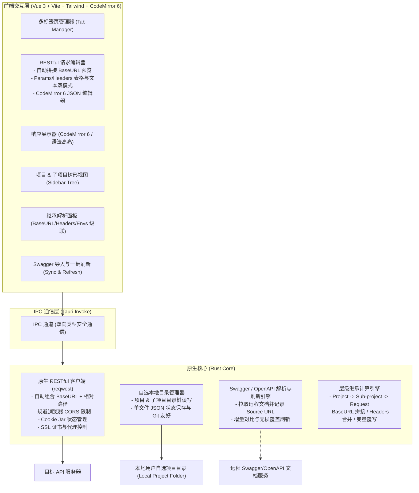

# JustAPI 🚀

> 极简、轻快、纯本地、无登录绑定的跨平台 RESTful API 调试客户端（支持 macOS & Windows）。

[](LICENSE)
[]()
[](https://tauri.app/)
[](https://vuejs.org/)

---

## 💡 为什么做 JustAPI？

目前主流的 API 调试工具逐渐变得愈发臃肿：
- **强制云端登录**：甚至把本地敏感数据强行上传云端，带来接口安全与泄露风险。
- **资源占用居高不下**：基于重型 Electron，冷启动需要数秒，动辄占用 500MB~1GB 内存。
- **过度设计与协议冗余**：充斥着团队治理、监控计费及普通开发者极少用到的复杂非 RESTful 协议。

**JustAPI 的核心准则：**
1. **专精 RESTful**：砍掉一切不必要的高复杂度非 RESTful 协议，将日常 95% 以上高频调试体验做到极致。
2. **目录即项目 (Folder-as-Project)**：支持自由选择任意本地磁盘目录作为存储空间，天然支持 Git 版本协同。
3. **主项目与子项目层级继承**：子项目的 BaseURL、通用 Headers、环境变量均可直接继承主项目或按需覆盖，请求发送时自动拼接。
4. **Swagger/OpenAPI 一键无损刷新**：支持从远程 URL 一键导入接口并持久化源绑定，后端接口更新时支持一键增量合并并保留用户已填参数。
5. **表格与纯文本双模式快速编辑**：Params 与 Headers 支持在「键值对表格」与「纯文本 Bulk Edit」之间无缝双向解析。
6. **轻量极速与纯本地离线**：毫秒级冷启动，严格裁剪运行时内存，离线即用，零账号绑定。

---

## ✨ 核心特性

- 📂 **本地优先与 Git 友好**：单请求单 JSON 文件存储，调试历史自动纳入 `.gitignore`，多人协作零合并冲突。
- 🔗 **三维层级级联继承**：BaseURL 自动拼接、通用 Headers 自动合并、环境变量按层级精准覆盖。
- 🔄 **Swagger / OpenAPI 智能无损合并**：一键刷新接口规范，自动标记已下线接口，绝不物理删除或冲掉用户的测试参数。
- ⚡ **高性能 JSON 编辑与处理**：基于 CodeMirror 6，严禁随意篡改排版；格式化与压缩交由 Rust 原生 `serde_json` 异步非阻塞执行，并具备超大响应截断保护。
- ⌨️ **极速操作流**：全局快捷键收敛防冒泡，Headers 联想补全选定即关并自动聚焦 Value，多 Tab 会话自动恢复。
- 🎨 **现代化桌面外观**：沉浸式原生窗口融合、侧边栏拖拽调宽与记忆、深色 / 浅色 / 跟随系统主题自适应。

---

## 🏗️ 架构设计与技术栈

### 技术栈
- **桌面底座**：Tauri 2.0 (Rust) + `reqwest` (开启 gzip / brotli / multipart / cookies) + `tokio`
- **前端体系**：Vue 3 (Composition API) + TypeScript + Vite
- **UI 与样式**：Tailwind CSS + `shadcn-vue` (基于 Radix Vue) + `lucide-vue-next`
- **代码编辑器**：CodeMirror 6（整包轻量 ~200KB，秒级冷启）
- **状态管理**：Pinia + `@vueuse/core`

### 性能与内存优化实况
- **macOS**：基于 WebKit 原生单进程渲染，真实运行时常驻内存仅约 **40MB ~ 60MB**。
- **Windows**：通过在 Rust 入口向 WebView2 注入专属精简参数（剥离独立 GPU 进程、限制渲染进程数、抑制后台无用网络），将常驻内存从默认的 150MB+ 严格控制在 **80MB 左右**。
- **冷启动耗时**：实测 ≤ 0.8 秒。

### 架构流程图


---

## 📁 本地数据存储规范

JustAPI 允许用户自由选择磁盘任意文件夹作为项目根目录（例如直接指向后端仓库中的 `docs/api` 目录）：

```text
my-mall-api/                              # 用户选择的主项目根目录
├── .justapi/
│   └── project.json                      # 主项目全局配置 (BaseURL, 通用 Headers, 多套环境)
├── user-service/                         # 子项目模块 1 (微服务/业务分组)
│   ├── .subproject.json                  # 子项目配置 (继承/覆盖规则, 绑定的 Swagger URL)
│   ├── login.json                        # RESTful 请求定义 (独立单文件)
│   └── get-profile.json
├── order-service/                        # 子项目模块 2
│   ├── .subproject.json
│   └── create-order.json
├── history.json                          # 本地调试历史记录 (上限 200 条，不存大响应体)
└── .gitignore                            # 自动将 history.json 加入忽略清单，避免污染仓库
```

---

## 🚀 快速启动

### 运行环境要求
- Node.js >= 18
- Rust 工具链 (`rustup` / `cargo` stable)

### 开发与打包命令
```bash
# 安装依赖
npm install

# 启动开发环境 (包含热重载桌面窗口)
npm run tauri dev

# 跨平台构建打包 (生成轻量 Release 安装包)
npm run tauri build
```

---

## 📖 详细使用与开发指南

关于完整的功能操作步骤、全局快捷键、动态插值语法、网络高级配置等，请参阅：

👉 **[查看完整使用与开发指南 (doc.md)](doc.md)**

---

## 📄 开源许可证 (License)

本项目采用 [Apache License 2.0](LICENSE) 许可证开源。
