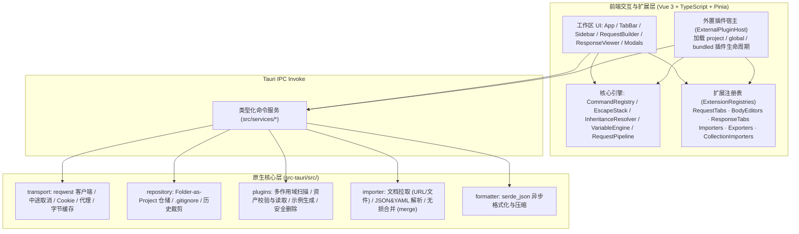

# JustAPI

> 极简、轻快、纯本地、无登录绑定的跨平台 RESTful API 调试桌面客户端（基于 Tauri 2 + Vue 3）。

[](LICENSE)
[]()
[](https://tauri.app/)
[](https://vuejs.org/)

---

## 💡 设计理念

JustAPI 专注日常高频的 **RESTful API** 调试与接口协作工作流，保持轻量级桌面原生体验：

1. **纯本地离线，零账号绑定**：无需注册登录，敏感接口配置与凭据全部保存在本地目录。
2. **目录即项目 (Folder-as-Project)**：可直接指向后端仓库或独立接口文档目录，单请求单 JSON 文件落盘，自动屏蔽历史记录，天然适配 Git 协作。
3. **三维层级继承 (`主项目 -> 子项目 -> 单请求`)**：BaseURL、通用 Headers 与环境变量逐层继承与局部覆写，配合实时生效预览减少重复配置。
4. **原生内核驱动**：HTTP 请求、文件上传、JSON 格式化与磁盘仓储均由 Rust（`reqwest` + `tokio` + `serde_json`）异步执行，规避浏览器 CORS 限制。
5. **插件化扩展架构 (`.justapi/plugins/`)**：Swagger/OpenAPI 同步、cURL 导入导出与响应断言均以标准插件形式承载，支持热重载、按项目启停与自定义扩展。

---

## ✨ 核心特性

### 1. 目录即项目与三维级联继承
- **BaseURL 级联解析**：子项目支持继承主项目根 BaseURL 并拼接服务前缀（如 `/auth`），也可切换为独立 BaseURL；URL 栏自动展示「拼接预览」与变量替换后的「实际发送地址」。
- **Headers 级联与排查**：支持主项目全局 Headers、子项目 Headers 与单请求 Headers 三层合并，请求面板 **Headers** 内置「最终生效」视图，可追踪每条请求头的继承来源与覆盖状态。
- **Git 友好目录结构**：单接口按 JSON 文件存储并支持分组子目录，加载项目时自动将调试历史 `history.json` 写入 `.gitignore`。

### 2. 高效请求构建与双模式编辑
- **全 RESTful 方法与参数解析**：支持 `GET` / `POST` / `PUT` / `DELETE` / `PATCH` / `HEAD` / `OPTIONS`，输入 `/users/{id}` 或 `:id` 自动同步生成 Path Params 行。
- **表格 / 纯文本双向编辑**：Query Params 与 Headers 支持键值对表格和 Bulk 纯文本（`key: value` / `key=value`）实时互转。
- **Headers 智能补全浮层**：Teleport 独立浮层渲染常见请求头与取值建议，选定即关并自动衔接输入流。
- **丰富请求体类型**：内置 `none`、`JSON`（CodeMirror 6）、`form-data`（支持文件选择上传）、`x-www-form-urlencoded`、`Raw Text`。

### 3. 响应检视与原生性能
- **Rust 原生客户端**：支持 `gzip` / `brotli` 解压、`multipart` 上传、Cookie 解析、请求中途取消（Cancel）、忽略自签名 SSL 证书以及 HTTP / SOCKS 代理。
- **高性能 JSON 处理**：CodeMirror 6 默认保留用户原始输入排版，可按需通过 Rust `serde_json` 异步执行 JSON 美化或单行压缩；自动识别响应体中的 JSON / HTML / XML / 图片，支持 `Pretty` / `Raw` / `Preview` 视图与关键词搜索。
- **Cookie Jar 与无损落盘**：内置按域名匹配注入的 Cookie Jar 管理；支持将响应原始字节或格式化后的 JSON 无损另存为本地文件（后端维护最近 20 条 / 总计 64 MB 响应字节缓存）。

### 4. 环境变量与动态插值
- 支持主项目多套环境配置（如 Dev / Test / Prod）快速切换，以及子项目同名变量覆写。
- 输入框与 URL 实时解析 `{{variable}}` 并用颜色徽章标注变量来源（系统动态 / 子项目覆盖 / 主项目环境 / 未定义）。
- 内置系统动态变量：
  - `{{$guid}}` / `{{$uuid}}`：随机 UUID v4
  - `{{$timestamp}}`：10 位 Unix 秒级时间戳
  - `{{$timestampMs}}`：13 位毫秒级时间戳
  - `{{$randomInt}}`：0 ~ 1000 随机整数

### 5. 插件系统（`.justapi/plugins/`）
JustAPI 内置 **External Plugin Host（V1 API）**，默认随应用内置以下三个标准插件，均可在「插件管理」中按项目启用或禁用：

| 内置插件 ID | 名称 | 核心能力 |
| :--- | :--- | :--- |
| `justapi.swagger` | Swagger / OpenAPI 导入同步器 | 解析 Swagger 2.0 与 OpenAPI 3.0/3.1（JSON/YAML），按 Tag 自动分组、同步 BaseURL，并支持 `Cmd/Ctrl + R` 无损增量刷新（保留已填参数与扩展数据，下线接口标记 `[已下线]` 而不误删文件） |
| `justapi.curl` | cURL 导入与导出 | 将 `curl` 命令解析为请求参数（Method / URL / Query / Header / JSON / Form / Basic Auth），或将当前请求一键复制导出为 POSIX cURL |
| `justapi.assertions` | 响应断言校验 (Assertions) | 在请求标签页编写 Status、耗时、Header、JSONPath 与响应体断言规则（持久存于请求 `extensions.assertions`），并在响应标签页展示通过/失败校验报告 |

插件支持 **项目级 > 全局级 > 内置级** 三级作用域按 `id` 优先级覆盖与热重载，自定义扩展开发详见 **[开发者与插件开发指南 (doc.md)](doc.md)**。

### 6. 桌面交互与细节体验
- **主题自适应**：支持深色、浅色与跟随系统主题切换。

---

## ⌨️ 常用快捷键

| 快捷键 | 功能说明 |
| :--- | :--- |
| `Cmd / Ctrl + Enter` | 发送当前激活标签页的请求（或在导入弹窗中确认解析） |
| `Cmd / Ctrl + S` | 保存当前请求（草稿将弹出归属子项目选择窗） |
| `Cmd / Ctrl + T` | 新建请求标签页 |
| `Cmd / Ctrl + W` | 关闭当前标签页 |
| `Cmd / Ctrl + \` | 展开 / 收起左侧边栏 |
| `Cmd / Ctrl + R` | 刷新当前子项目关联的接口集合文档（如 Swagger / OpenAPI） |
| `Cmd / Ctrl + F` | 聚焦集合树搜索框（在集合树激活且侧边栏可见时） |
| `Shift + Alt + F` | 美化格式化当前 JSON 请求体 |
| `Esc` | 逐层关闭当前浮层 / 确认框 / 模态弹窗 / 下拉菜单，或清空已聚焦的搜索框 |

---

## 🏗️ 架构设计与技术栈

### 技术栈
- **桌面壳与原生层**：Tauri 2 (`tauri` 2.12)、Rust (Edition 2024 / >= 1.90)、`reqwest` 0.12（`rustls-tls`、`gzip`、`brotli`、`multipart`、`cookies`）、`tokio`、`serde_json`、`serde_yaml`、`rfd`
- **前端界面层**：Vue 3.5 (`<script setup>`)、TypeScript 5.7、Pinia 3、Vite 6、Tailwind CSS 3、`radix-vue`、`@vueuse/core`、`lucide-vue-next`
- **代码编辑器**：CodeMirror 6（`@codemirror/view`、`@codemirror/state`、`@codemirror/commands`、`@codemirror/lang-json`、`@codemirror/language`、`@codemirror/theme-one-dark`）
- **测试框架**：Vitest 3（前端逻辑/插件测试）+ Rust `cargo test`

### 系统分层



### 仓库目录概览

```text
JustAPI/
├── .justapi/plugins/                # 官方内置插件源码 (编译时随 Rust 内嵌发布)
│   ├── assertions/                  # 响应断言插件 (justapi.assertions)
│   ├── curl/                        # cURL 导入导出插件 (justapi.curl)
│   └── swagger/                     # Swagger/OpenAPI 导入同步插件 (justapi.swagger)
├── src/
│   ├── core/                        # 核心与框架无关逻辑 (命令/继承/插值/管线/插件宿主/注册表/Esc 栈)
│   ├── composables/                 # Vue 组合式函数 (useEscapeCancel, useTheme)
│   ├── features/                    # 业务视图模块 (sidebar, request-builder, response-viewer)
│   ├── components/                  # 通用组件、弹窗 (modals/)、TabBar 与 UrlBar
│   ├── services/                    # Tauri IPC 调用封装 (transport/workspace/plugin/formatter)
│   ├── stores/                      # Pinia 状态管理 (appStore, sessionStore, workspaceStore)
│   └── __tests__/                   # Vitest 单元测试
└── src-tauri/src/
    ├── commands/                    # Tauri 命令入口 (transport/workspace/plugins/importer/formatter)
    ├── domain/                      # 跨端共享结构定义与 Schema 常量
    ├── transport/                   # HTTP 请求执行、取消句柄与响应字节缓存
    ├── repository/                  # 本地目录协议持久化
    ├── plugins/                     # 外置插件发现、资产安全校验与管理
    ├── importer/                    # 通用导入拉取与无损集合合并逻辑
    └── formatter/                   # Rust JSON 格式化与压缩实现
```

---

## 📁 本地项目存储规范

打开任意本地文件夹作为项目后，JustAPI 按如下结构组织文件：

```text
your-api-workspace/                  # 用户打开的项目根目录
├── .justapi/
│   ├── project.json                 # 全局配置 (项目名, BaseURL, 全局 Headers, 多环境, 网络配置, disabledPlugins)
│   └── plugins/                     # 项目级外置插件目录 (可选，支持随 Git 分发给团队成员)
│       └── my-plugin/
│           ├── manifest.json
│           └── index.mjs
├── user-service/                    # 子项目模块目录
│   ├── .subproject.json             # 子项目配置 (继承开关, 覆盖变量, 关联的集合导入源)
│   ├── auth/                        # 分组子目录 (可选，对应界面树形分组)
│   │   └── login.json               # 单个请求定义 (含 extensions 扩展字段)
│   └── profile.json
├── history.json                     # 最近调试历史 (最多保留 200 条)
└── .gitignore                       # 自动追加 history.json，避免本地调试历史污染 Git
```

---

## 🚀 快速启动与开发命令

### 环境要求
- **Node.js**：`>= 18`（推荐 `20.x`）
- **Rust 工具链**：稳定版 `>= 1.90`（`edition = "2024"`）
- **Linux 构建系统依赖**（仅 Ubuntu/Debian 等需桌面打包时）：`libwebkit2gtk-4.1-dev`、`libappindicator3-dev`、`librsvg2-dev`、`patchelf`、`xdg-utils`

### 常用命令

```bash
# 1. 安装前端依赖
npm install

# 2. 启动 Tauri 桌面端开发环境 (Vite 热重载 + Rust 原生窗口)
npm run tauri dev

# 3. 仅前端类型检查与生产构建 (vue-tsc --noEmit && vite build)
npm run build

# 4. 运行前端与插件单测 (Vitest)
npm test

# 5. 运行 Rust 核心与仓储单测
cargo test --manifest-path src-tauri/Cargo.toml

# 6. 构建桌面安装包 (.dmg / .msi / .AppImage / .deb)
npm run tauri build
```

---

## 📖 文档导航

- **软件使用教程**：从上手建项目、级联继承、Swagger 同步到插件日常使用，请参阅 **[usage.md](usage.md)**
- **开发者与插件开发指南**：架构模块、外置插件目录规范、`JustAPIPluginContext` API 参考与构建发布，请参阅 **[doc.md](doc.md)**

---

## 📄 开源许可证 (License)

本项目基于 [Apache License 2.0](LICENSE) 许可证开源。
